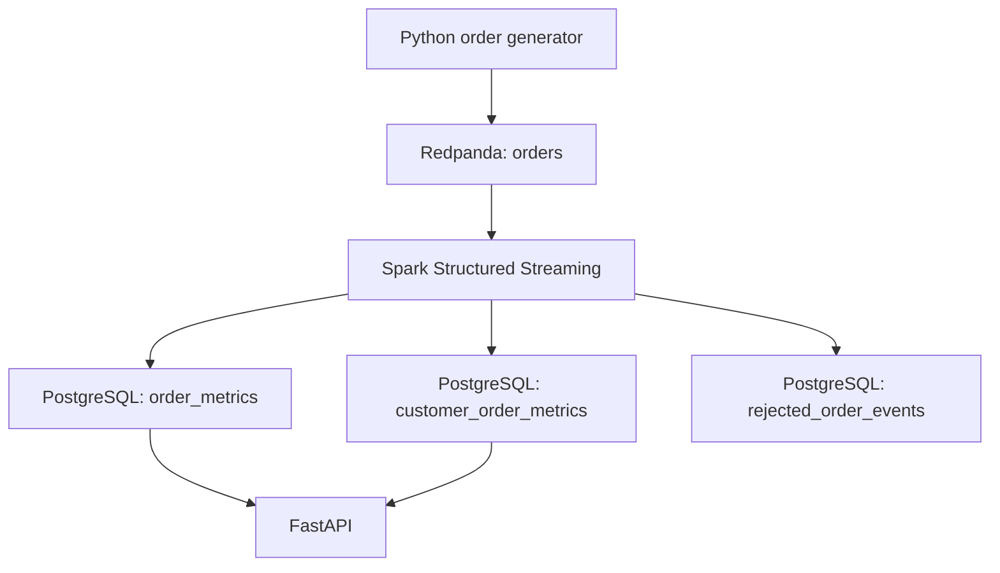

# Streaming Pipeline + Real-Time Metrics API

Generate synthetic orders, aggregate them as they arrive, and query the results through a REST API. The stack runs locally with Docker Compose.

## How it works



The Python producer sends synthetic orders to a three-partition Redpanda topic using the Kafka API. Spark uses the timestamp in each event to compute one-minute order counts and revenue by currency, plus one-minute order counts by currency and customer. Both aggregation queries use a two-minute watermark, keep separate checkpoints, and update PostgreSQL through upserts.

Invalid orders are excluded from the aggregates. A separate query records the rejection reason and the Kafka topic, partition, and offset in PostgreSQL.

FastAPI reads the stored aggregates and calculates rolling order counts, customer rankings, and order volume anomaly flags at request time.

## Run locally on Windows

Install Docker Desktop with Docker Compose and Python 3.11. Open PowerShell in the repository root and create a local database password:

```powershell
if (-not (Test-Path -LiteralPath .env)) {
    $metricsDbPassword = [guid]::NewGuid().ToString("N")
    Set-Content -LiteralPath .env -Value "POSTGRES_PASSWORD=$metricsDbPassword" -Encoding ascii
}
```

If you already have a local database from before the rejected orders table was added, apply its SQL script first. This keeps your existing data:

```powershell
docker compose up -d --wait postgres
docker compose exec -T postgres psql -X -U metrics -d streaming_metrics -v ON_ERROR_STOP=1 -f /docker-entrypoint-initdb.d/003_create_rejected_order_events.sql
```

Start the full stack:

```powershell
docker compose --progress plain up -d --build
docker compose ps --all
```

`topic-init` creates the `orders` topic and exits with code `0`. PostgreSQL runs the scripts in `sql/` when its data directory is first initialized. The first Spark startup may take a minute while the Kafka connector downloads.

Once the API is healthy, install the producer dependency and send five orders:

```powershell
python -m venv .venv
.\.venv\Scripts\python.exe -m pip install -r requirements.txt
.\.venv\Scripts\python.exe .\producer.py --count 5 --interval 0
```

Give Spark time to process the orders, then read the latest minute metrics:

```powershell
Invoke-RestMethod "http://127.0.0.1:8001/metrics/minute?limit=5" | ConvertTo-Json -Depth 5
```

## API examples

Open the [interactive API docs](http://127.0.0.1:8001/docs) or try these requests:

| Request | Result |
|---|---|
| `GET /metrics/minute?limit=5` | Recent minute totals, including order count and revenue in cents |
| `GET /metrics/rolling?currency=USD` | Total orders in the current UTC minute and the four preceding minutes |
| `GET /metrics/top-customers?currency=USD&limit=5` | Customers ranked by order count over the same five-minute window |
| `GET /metrics/anomaly?currency=USD&min_orders=5` | Whether the most recently ended UTC minute crossed the order volume threshold |

On `/metrics/minute`, follow `next_page` to fetch older metrics. Repeated requests for the same page use a five-second cache and report `HIT` or `MISS` in the `X-Cache` response header.

Use `at_minute` with a UTC timestamp from `window_start` to query an earlier window. The anomaly flag compares the selected minute with the average of the previous five minutes, treating missing minutes as zero. It flags counts that are at least twice that average and meet the minimum count, which defaults to 10.

## Verification and performance

- **API rules:** [GitHub Actions](https://github.com/malapatisaisony/streaming-metrics-api/actions/workflows/api-tests.yml) checks rolling window boundaries and anomaly thresholds.
- **Spark recovery:** The [recovery test](tests/smoke_recovery.py) processes five orders, stops Spark, and sends three more. After restart, both PostgreSQL aggregate tables and the API report eight orders.
- **Event time:** The [event time test](tests/smoke_event_time.py) verifies separate USD and EUR totals and accepts an order that arrived within the watermark allowance. A much older order left the earlier window unchanged in this test.
- **Invalid events:** The [malformed order test](tests/smoke_malformed_orders.py) verifies that invalid payloads, timestamps, and amounts are recorded in PostgreSQL while valid orders continue to be processed.
- **API reads:** An initial k6 run against 262,080 PostgreSQL rows measured 26.69 ms p95 at 25.02 requests/sec, with no failed requests or dropped iterations. A covering index enabled an index-only scan, but the API trials did not show a repeatable speedup. See the [read benchmark results](benchmarks/README.md).

### Order to API freshness

On Windows with Docker Desktop, each trial sent 30 synthetic orders at one order per second. The benchmark timed each order from the producer send to the first `/metrics/minute` response showing it. The results exclude startup and warm-up and include Spark batch scheduling, the API's five-second cache, and client polling at roughly half-second intervals.

| Trial | Orders | Send rate | p50 | p95 | Max |
|---|---:|---:|---:|---:|---:|
| 1 | 30 | 1.00 order/s | 14.90 s | 25.44 s | 26.44 s |
| 2 | 30 | 1.00 order/s | 12.20 s | 17.42 s | 18.42 s |

Both PostgreSQL aggregate tables and the API counted 61 orders, including the warm-up order. These results describe two local runs at the stated send rate.

To reproduce from the repository root after installing the producer dependency:

```powershell
docker compose -p streaming-metrics stop
.\.venv\Scripts\python.exe .\benchmarks\freshness.py
```

The benchmark creates and removes its own temporary Compose stack and volumes.

## Stop the local stack

To stop the regular stack and keep its data and checkpoints:

```powershell
docker compose stop
```