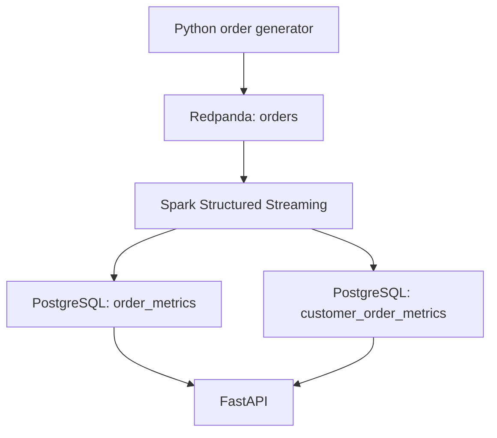

# Streaming Pipeline + Real-Time Metrics API

Generate synthetic orders, aggregate them as they arrive, and query the
results through a REST API. The stack runs locally with Docker Compose.

## How it works



Redpanda receives events on a three-partition Kafka-compatible topic. Spark
uses the timestamp in each event to calculate one-minute order counts and
revenue by currency, plus one-minute counts per customer. Both streaming
queries use a two-minute watermark and have separate checkpoints. They
write updated totals to PostgreSQL using upserts.

FastAPI reads the stored minute aggregates to serve rolling counts, customer
rankings, and order volume flags.

## Run locally on Windows

Install Docker Desktop with Docker Compose and Python 3.11. Open PowerShell
in the repository root and create a local database password:

```powershell
if (-not (Test-Path -LiteralPath .env)) {
    $metricsDbPassword = [guid]::NewGuid().ToString("N")
    Set-Content -LiteralPath .env -Value "POSTGRES_PASSWORD=$metricsDbPassword" -Encoding ascii
}
```

Start the stack:

```powershell
docker compose --progress plain up -d --build
docker compose ps --all
```

`topic-init` creates the `orders` topic and exits with code `0`. PostgreSQL
initializes both tables from `sql/` on its first startup. The first Spark
startup may take a minute while the Kafka connector downloads.

Once the API is healthy, install the producer dependency and send five orders:

```powershell
python -m venv .venv
.\.venv\Scripts\python.exe -m pip install -r requirements.txt
.\.venv\Scripts\python.exe .\producer.py --count 5 --interval 0
```

Give Spark time to process the orders, then read the latest minute metrics:

```powershell
$metricsBase = "http://127.0.0.1:8001"
Invoke-RestMethod "$metricsBase/metrics/minute?limit=5" | ConvertTo-Json -Depth 5
```

## API examples

Open [the interactive API docs](http://127.0.0.1:8001/docs) or try these requests:

| Request | Result |
|---|---|
| `GET /metrics/minute?limit=5` | Recent minute totals, including order count and revenue in cents |
| `GET /metrics/rolling?currency=USD` | Total orders in the current UTC minute and the four preceding minutes |
| `GET /metrics/top-customers?currency=USD&limit=5` | Customers ranked by order count over the same five-minute window |
| `GET /metrics/anomaly?currency=USD&min_orders=5` | Whether the most recently ended UTC minute crossed the order volume threshold |

Follow `next_page` to fetch older minute metrics. Repeated requests for the
same page use a five-second cache and report `HIT` or `MISS` in `X-Cache`.

Use `at_minute` with a UTC timestamp from `window_start` to query an earlier
window. The anomaly flag compares the selected minute with the average of the
previous five minutes, treating missing minutes as zero. It flags counts that
are at least twice that average and meet the minimum count, which defaults
to 10.

## Verification and performance

- **Fresh startup:** In a separate Compose project with empty volumes, five
  generated orders appeared in both the API totals and the customer counts.
- **Spark recovery:** Three more orders were sent while Spark was stopped.
  After restart, both totals reached eight, and both queries continued from
  their checkpoints.
- **Read benchmark:** On a fixture of 262,080 minute rows, the initial
  `/metrics/rolling` run reached 25.02 requests/sec at 26.69 ms p95 with no
  failures or dropped requests. A covering index enabled an index-only scan,
  but the API trials did not show a repeatable speedup. See the
  [full benchmark results](benchmarks/README.md).

Stop the services and keep the local data and checkpoints:

```powershell
docker compose stop
```