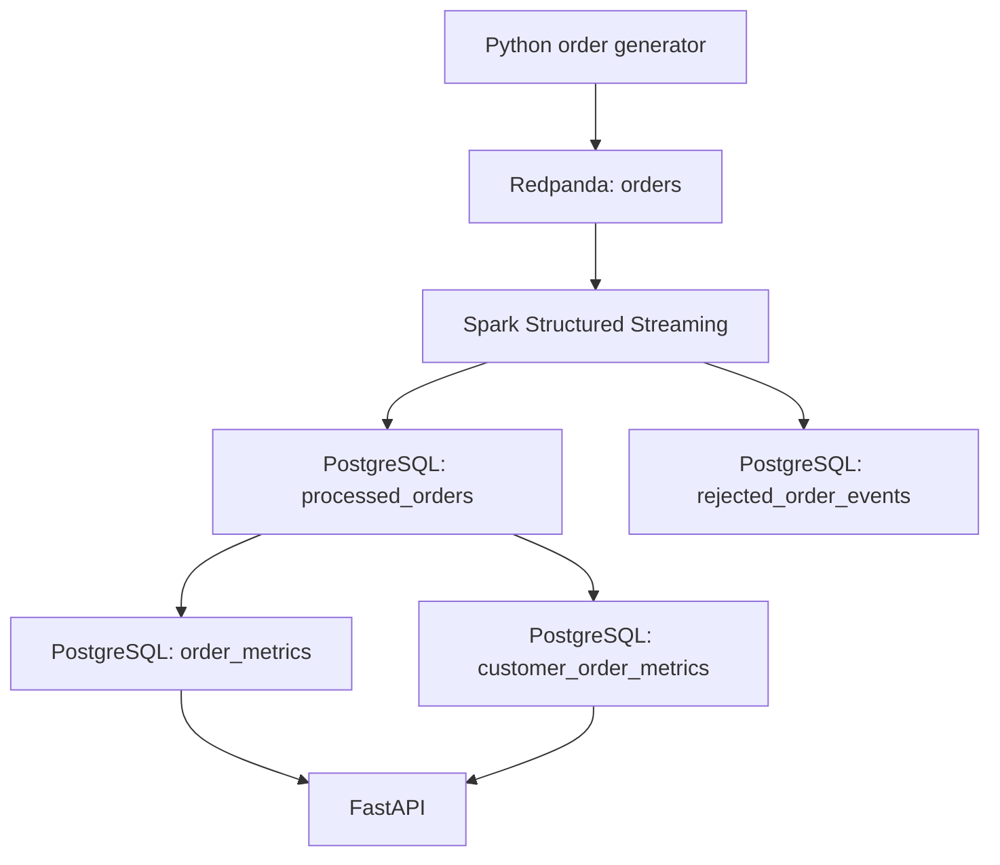

# Streaming Pipeline + Real-Time Metrics API

Generate synthetic orders, aggregate them as they arrive, and query the results through a REST API. The stack runs locally with Docker Compose.

## How it works



The Python producer sends synthetic orders to a three-partition Redpanda topic using the Kafka API. Spark validates the records, applies a two-minute event-time watermark, and assigns valid orders to one-minute UTC windows.

PostgreSQL stores each accepted `order_id` once in `processed_orders`. Only newly inserted orders contribute to the minute counts, revenue, and per-customer counts. The order insert and both aggregate updates commit in one transaction, so a replay cannot increment the totals for an ID already in the ledger.

Invalid orders are excluded from the aggregates. A separate query records the rejection reason and the Kafka topic, partition, and offset in PostgreSQL.

Valid orders whose event time is older than Spark's current watermark are dropped before aggregation and do not create a row in `rejected_order_events`.

FastAPI reads the stored aggregates and calculates rolling order counts, customer rankings, and order volume anomaly flags at request time.

## Run locally on Windows

Install Docker Desktop with Docker Compose and Python 3.11. Open PowerShell in the repository root and create a local database password:

```powershell
if (-not (Test-Path -LiteralPath .env)) {
    $metricsDbPassword = [guid]::NewGuid().ToString("N")
    Set-Content -LiteralPath .env -Value "POSTGRES_PASSWORD=$metricsDbPassword" -Encoding ascii
}
```

On a fresh checkout, start the full stack:

```powershell
docker compose --progress plain up -d --build
docker compose ps --all
```

If your local volumes were created before duplicate protection was added, stop the old project and start the updated stack as a new project:

```powershell
docker compose -p streaming-metrics stop
docker compose --progress plain -p streaming-metrics-v2 up -d --build
docker compose -p streaming-metrics-v2 ps --all
```

Use `-p streaming-metrics-v2` for subsequent Compose commands on that stack. It has fresh data and checkpoints; the old project's volumes stay intact.

`topic-init` creates the `orders` topic and exits with code `0`. PostgreSQL runs the scripts in `sql/` when its data directory is first initialized. The first Spark startup may take a minute while the Kafka connector downloads.

Once the API is healthy, install the producer dependency and send five orders:

```powershell
python -m venv .venv
.\.venv\Scripts\python.exe -m pip install -r requirements.txt
.\.venv\Scripts\python.exe .\producer.py --count 5 --interval 0
```

Give Spark time to process the orders, then read the latest minute metrics:

```powershell
Invoke-RestMethod "http://127.0.0.1:8001/metrics/minute?limit=5" | ConvertTo-Json -Depth 5
```

## API examples

Open the [interactive API docs](http://127.0.0.1:8001/docs) or try these requests:

| Request | Result |
|---|---|
| `GET /metrics/minute?limit=5` | Recent minute totals, including order count and revenue in cents |
| `GET /metrics/rolling?currency=USD` | Total orders in the current UTC minute and the four preceding minutes |
| `GET /metrics/top-customers?currency=USD&limit=5` | Customers ranked by order count over the same five-minute window |
| `GET /metrics/anomaly?currency=USD&min_orders=5` | Whether the most recently ended UTC minute crossed the order volume threshold |

On `/metrics/minute`, follow `next_page` to fetch older metrics. Repeated requests for the same page use a five-second cache and report `HIT` or `MISS` in the `X-Cache` response header.

Use `at_minute` with a UTC timestamp from `window_start` to query an earlier window. The anomaly flag compares the selected minute with the average of the previous five minutes, treating missing minutes as zero. It flags counts that are at least twice that average and meet the minimum count, which defaults to 10.

## Verification and performance

- **Pipeline smoke tests:** The [manual GitHub Actions workflow](https://github.com/malapatisaisony/streaming-metrics-api/actions/workflows/spark-recovery.yml) runs restart recovery, event-time and currency grouping, malformed order handling, and duplicate order protection in separate jobs. [All four passed on commit `4414b25`](https://github.com/malapatisaisony/streaming-metrics-api/actions/runs/45276447096).
- **API rules:** [GitHub Actions](https://github.com/malapatisaisony/streaming-metrics-api/actions/workflows/api-tests.yml) checks rolling window boundaries and anomaly thresholds.
- **Spark recovery:** The [recovery test](tests/smoke_recovery.py) processes five orders, stops Spark, and sends three more. After restart, both PostgreSQL aggregate tables and the API report eight orders.
- **Event time:** The [event time test](tests/smoke_event_time.py) verifies separate USD and EUR totals and accepts an order that arrived within the watermark allowance. A much older order left the earlier window unchanged in this test.
- **Invalid events:** The [malformed order test](tests/smoke_malformed_orders.py) verifies that invalid payloads, timestamps, and amounts are recorded in PostgreSQL while valid orders continue to be processed.
- **Duplicate orders:** The [duplicate order test](tests/smoke_duplicate_orders.py) sends three Kafka records representing two distinct orders around a Spark restart. It checks for two orders, 3500 cents in revenue, and one order per customer.
- **API reads:** An initial k6 run against 262,080 PostgreSQL rows measured 26.69 ms p95 at 25.02 requests/sec, with no failed requests or dropped iterations. A covering index enabled an index-only scan, but the API trials did not show a repeatable speedup. See the [read benchmark results](benchmarks/README.md).

### Order to API freshness

On Windows with Docker Desktop, the pipeline with duplicate order protection ran three trials of 30 synthetic orders at one order per second. Freshness measures the time from the producer send to the first `/metrics/minute` response showing that order. Startup and the warm-up order are excluded.

| Trial | Orders | Send rate | p50 | p95 | Max |
|---|---:|---:|---:|---:|---:|
| 1 | 30 | 1.00 order/s | 8.33 s | 13.23 s | 13.66 s |
| 2 | 30 | 1.00 order/s | 10.33 s | 15.22 s | 15.69 s |
| 3 | 30 | 1.00 order/s | 9.76 s | 15.94 s | 16.94 s |

Spark reported these durations for the nonempty order batches. `triggerExecution` is the active trigger duration; `addBatch` is the part of that trigger that processes the batch and writes the results to PostgreSQL.

| Trial | Batches | Trigger p50 | Trigger max | addBatch p50 | addBatch max |
|---|---:|---:|---:|---:|---:|
| 1 | 4 | 2560.5 ms | 2712.0 ms | 2241.5 ms | 2374.0 ms |
| 2 | 4 | 2086.0 ms | 2131.0 ms | 1942.0 ms | 1969.0 ms |
| 3 | 4 | 2007.5 ms | 2071.0 ms | 1874.0 ms | 1899.0 ms |

Both PostgreSQL aggregate tables and the API counted 91 orders, including one warm-up order. The longest active trigger took 2.712 seconds. Order-to-API freshness also includes waiting for Spark's next 10-second trigger, the API's five-second cache, and client polling at roughly half-second intervals. The benchmark does not measure those contributions separately.

For comparison, the [earlier baseline](https://github.com/malapatisaisony/streaming-metrics-api/blob/73fe72ac9d26e7274f0bfc5657e10af6cce6aed2/README.md#order-to-api-freshness) measured p95 of 25.44 s and 17.42 s in two 30-order trials at the same send rate. The newer trials observed lower p95 values on this local setup, without isolating which changes caused the difference.

To reproduce from the repository root after installing the producer dependency:

```powershell
docker compose -p streaming-metrics stop
.\.venv\Scripts\python.exe .\benchmarks\freshness.py
```

If your regular stack is named `streaming-metrics-v2`, use that name in the stop command. The benchmark creates and removes its own temporary Compose stack and volumes.

## Stop the local stack

To stop the regular stack and keep its data and checkpoints, run the command below. Add `-p streaming-metrics-v2` after `docker compose` if you used that project name.

```powershell
docker compose stop
```
